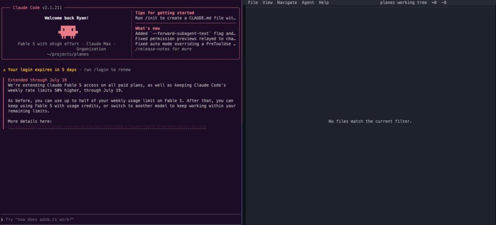
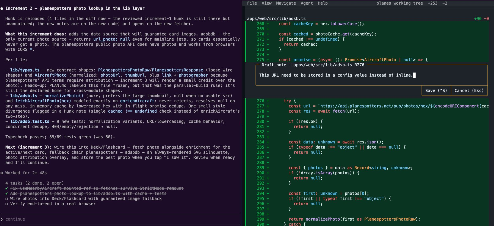

**Want more control over the code an agent is writing?** Writing a prompt and getting a result is easy, but sometimes you want more oversight on where the code is going before you get a large diff. In this quick article I'm going to show a workflow I've been using when I want more of a handle on the direction of the code an agent is writing.

Before we continue, you'll need to install [hunk.dev](https://www.hunk.dev/). Hunk is a great diff viewer that works well with coding agents. With Hunk, you get a nice diff viewer that your agent can annotate code and read notes you write in the diff. This article is not an intro to Hunk, but there's a great, quick video introduction [here](https://x.com/Jilles/status/2072732917449519531).

## 1. Start Hunk

```
hunk diff --watch
```

I'm normally using a split view to do this so I can keep my agent in one pane, and Hunk in another.



## 2. Write a prompt

Tell the agent to plan your work, move in small increments, and that you're using Hunk.

**Example Prompt:**

```
{main prompt}. Plan this thoroughly and work in small increments.
I want to treat the work more like pair programming instead of a
single update.

I'll be using Hunk to review the changes.
Run `hunk skill path` to get the skill path.
For each step give me an overview here and
let me review the diff in Hunk.

Add notes for the major updates in the diff view.
```

## 3. Review the changes



The hunk pane should update with the diff for the current changes. You can review the code, add notes to leave feedback/questions on the code in the diff view, and tell the agent to address these comments and questions. This is the same feedback loop as a PR review, but local, before any code is committed.

## 4. Iterate

Work through the diff until you're happy with the output code, commit to git *(optional but recommended)*, and tell the agent to continue to the next step.

## 5. Make a skill

If you like this workflow and want to reuse it on future work, you can tell your agent to make a skill.

[This is not a workflow I use all the time](https://x.com/ryanlanciaux/status/2073506810351493268), but it's been useful when I want to stay in control of the code an agent is writing. I'd love to know what patterns you're using to achieve similar results.
