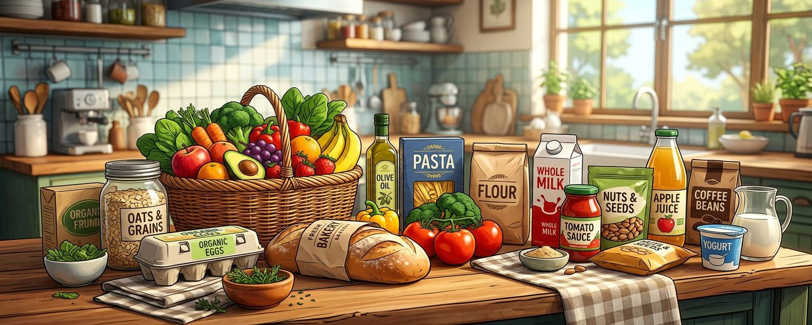
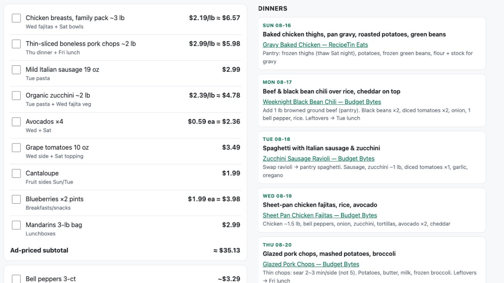

Groceries are expensive and planning meals takes time. AI tools can help with both, and the savings can more than cover the subscription cost. This is a quick, file based system for managing meals and groceries with LLMs. There's no code you need to manage, no database. Some of the file organization techniques may look familiar if you're a software developer.

## The system in action

*What a typical request looks like once everything is set up. Scroll to the end of the article if you just want the SETUP.md you can run.*

> "I want a meal plan for the following week. I've attached circulars for the following stores, and we're out on Friday night for dinner with friends. In addition to the foods that were previously tracked, I have frozen chicken that can be used for one of the meals. I'd prefer to do most of my shopping at {store}. I want both a shopping list and reference meal plan with cited recipes in both markdown and HTML so I can view it in the store."



**The overall gist:**

1. Describe the week
2. Provide the ads / circulars for the stores you want to shop at. This is the part that takes me the longest but I attach the circulars to the chat.
3. Define the output. I almost always note that I want an HTML version of the list and the plan so I can view it on my phone.

> Outside the scope of this article, but a [Cloudflare tunnel](https://developers.cloudflare.com/tunnel/) or [ngrok](https://ngrok.com/) plus a simple http server lets you pull up the plan and list on your phone while you're at the store.

## The project structure

1. **INSTRUCTIONS.md** - The rules the agent must follow and general information about your household. This contains things like household size (for recipe scale), allergens, food to minimize, and budget principles.

   ⚠️ Always double check when it comes to things like allergies since AI tools can get that sort of thing wrong.
2. **Agent on-ramp.** I use *CLAUDE.md* but however you tell future sessions where to start.
3. **State files:**

| File | Purpose |
|------|---------|
| `pantry-inventory.md` | Food items on hand. Seeded via a photo audit of fridge/freezer/pantry |
| `meal-favorites.md` | A durable recipe store. Meals earn a spot by being cooked and liked. Say "Add this meal to favorites" and the agent records it |
| `plans/` | One Sunday-dated plan per week (this includes the shopping list) |
| `ads/YYYY-MM-DD/` | Weekly circular PDFs, plus a screened `eligible-items.json` the agent generates |

With this in place, the agent screens the provided ads, builds an ephemeral `eligible-items.json` file for ranking and exclusions, and drafts a plan and shopping list.

## Try it yourself

Below is the full SETUP.md. You'll need an agent that can read and write files and view images and PDFs (Claude Code, Claude Desktop with folder access, Cursor). Make an empty folder and open it with the agent. Paste the file in and say "Set this up." The agent will ask you a few questions and scaffold your project. Once it's done, photograph your fridge, freezer, and pantry so the agent can populate your inventory. From there, you're ready to run your first plan.

````markdown
# Meal & Grocery Planner — Setup Prompt

**How to use this:** Make an empty folder. Open it with an AI agent that can read
and write files (Claude Code, Claude Desktop with folder access, Cursor). Paste
this whole file into the chat and say **"set this up."**

No code, no database — just markdown files the agent keeps editing.

---

# AGENT: FOLLOW THIS

Set up a file-based meal-planning and grocery system. The user will describe
their week, provide store circulars, and ask for a meal plan plus shopping list.
Your job now is to scaffold the files and fill in their household rules.

## STEP 1 — Interview

Ask these in one message, numbered. Wait for answers.

1. **Household** — how many adults, how many kids? (Sets recipe scale.)
2. **Allergens** — anything to avoid *entirely*? Be specific: "nuts" isn't
   enough — tree nuts, peanuts, or both?
3. **Minimize** — anything to limit but not ban (dairy, gluten, added sugar…)?
   Get the actual foods, itemized — a list is checkable, a category name is not.
4. **Stores & budget** — which stores, and roughly what weekly spend?

> ⚠️ Allergies are the one place this system must never be wrong. Always
> double-check screened results — AI tools can get this sort of thing wrong.

## STEP 2 — Scaffold

```
./
├── CLAUDE.md              ← agent on-ramp (STEP 4)
├── INSTRUCTIONS.md        ← the rules + household info (STEP 3)
├── pantry-inventory.md    ← food on hand, seeded via a photo audit
├── meal-favorites.md      ← durable recipe store — meals earn a spot by being cooked and liked
├── plans/                 ← one Sunday-dated plan per week (includes the shopping list)
└── ads/                   ← ads/YYYY-MM-DD/ — weekly circular PDFs + screened eligible-items.json
```

All dates are ISO `YYYY-MM-DD`. Weekly folders and plan files are named for the
Sunday that starts the week. Get today's date from the environment, not memory.

Seed `pantry-inventory.md` with empty sections (`## Fridge`, `## Freezer`,
`## Pantry`, `## Produce`, `## Spices/Oils`) and `meal-favorites.md` with just a
title — both fill in through use.

## STEP 3 — Write INSTRUCTIONS.md

Use this template verbatim. Replace only the `{{...}}` slots with the interview
answers. Everything else is the method — keep it intact.

```markdown
# Meal & Grocery Planner — Instructions

## Household
{{N}} adults + {{N}} kids. Scale every recipe to that.
Terse and direct. When constraints collide, state the tradeoff — don't silently pick.

## Hard constraints (never violate)
- **Avoid entirely:** {{allergens}}. Check every recipe, sauce, bread, and packaged item.
- **Minimize:** {{itemized foods to limit}}.

Safety → nutrition → cost → convenience, in that order.

## Budget principles
- **Shop the ads.** Plans are built around this week's circulars.
- **A sale is a planning signal, not permission** — only deals that pass the constraints.
- **Rank by cost-per-serving**, not sticker price.
- **Every ingredient earns its place** by appearing in 2+ meals that week.
- Stores: {{stores}}. Weekly target: {{budget}}.

## Weekly plan (the standing workflow)

The user describes the week (nights out, extra food to use up, preferred store),
provides circulars, and defines the output. Then:

1. **Save and screen the ads.** Circulars live in `ads/<sunday>/`. Read every
   one and write `ads/<sunday>/eligible-items.json`: items, prices, valid-through
   dates, and — for anything excluded — which constraint it failed. This file is
   ephemeral working data for ranking and exclusions; regenerate it freely.
2. **Read `pantry-inventory.md`.** Never plan around imagined food. Fold in
   anything the user says they have on hand.
3. **Rank the eligible items** by cost-per-serving and favor the user's
   preferred store. Check `meal-favorites.md` — a favorite gets slotted in when
   its sale ingredient shows up in the ads.
4. **Draft `plans/<sunday>-plan.md`:** the week's meals (skipping nights the
   user said they're out, citing a source recipe for each meal) plus a shopping
   list grouped by store with prices.
5. **If the user asked for HTML** — and they usually will, for phone use in the
   store — also write `plans/<sunday>-plan.html`: one self-contained file, plan
   and list both, readable on a small screen.
6. **Cross-check** the finished plan against the hard constraints line by line
   before presenting it. Any hit, rewrite that meal.

## Tracking
- **`pantry-inventory.md`** — edit in the same turn food is bought, used, or
  runs out. It's the only stock record; if it drifts, every future plan is wrong.
- **`meal-favorites.md`** — a meal is added *only* when the user says
  **"add this meal to favorites"** (it was cooked and liked). Record: name,
  source recipe link, why it worked, and the sale ingredient that should
  re-trigger it in a future week's ads.
```

## STEP 4 — Write CLAUDE.md

A short on-ramp for the next session that opens this folder. It must say:

- This is a living-files project — nothing to build or test.
- **Read `INSTRUCTIONS.md` first; it is authoritative.** Don't rewrite it
  unless the user is explicitly changing the rules.
- **Read `pantry-inventory.md` before any "what can I make" question.** Don't guess.
- A file map: each file, what it's for, who edits it.

## STEP 5 — Hand off

Tell the user:

1. **Seed the pantry.** Photograph the fridge, freezer, and pantry shelves and
   share the photos — the agent fills in `pantry-inventory.md` from them.
   Nothing works well until this file reflects reality.
2. **Drop this week's circulars** into `ads/<next-sunday>/` (or just attach them
   in chat — the agent files them).
3. **Make the first request.** For example:

   > "I want a meal plan for the following week. I've attached circulars for
   > the following stores, and we're out Friday night. I also have frozen
   > chicken to use for one of the meals. I'd prefer to shop mostly at
   > {store}. Give me a shopping list and meal plan with cited recipes, in
   > both markdown and HTML so I can view it in the store."

(Tip, outside this setup's scope: a Cloudflare tunnel or ngrok plus a simple
HTTP server makes the HTML plan viewable on your phone at the store.)

Then stop. Don't generate a plan during setup — the pantry file isn't real yet.
````
