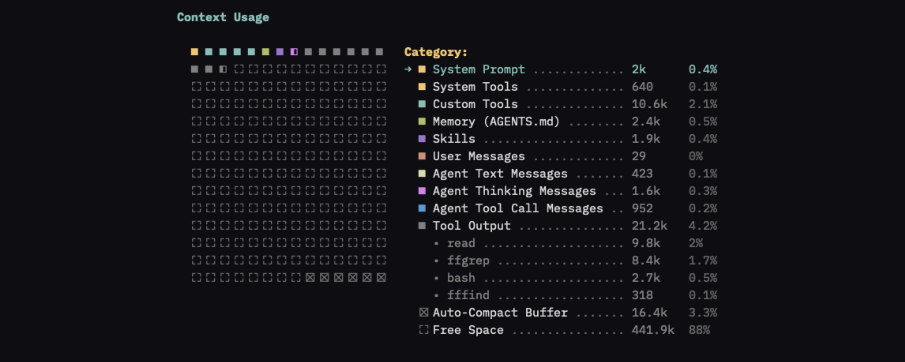
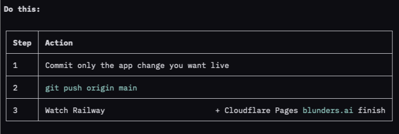

I'm trying [@pidotdev](https://x.com/pidotdev) as my daily driver so I'm not locked into any model and I have more control over the tools I use every day. The most capable model is going to keep changing, and I don't want to rebuild my setup every time.

**One big caveat:** I've been using Pi for less than 48 hours. This isn't a review, and it isn't exhaustive. With that out of the way, here's how I have Pi set up.

## Initial setup

I started from [Tim Messerschmidt's list](https://x.com/SeraAndroid/status/2088527265084686398). You should absolutely read the whole post but a couple of my favorites:

- [Ponytail](https://pi.dev/packages/@dietrichgebert/ponytail) - keeps the agent from overbuilding. Reuse what's there and don't remake something the platform already has.
- [context-view](https://pi.dev/packages/pi-context-view) - shows what's actually taking up space in the context window. The usage map reminds me of an old-school disk defrag screen, which is fun.

[@tyler_dot_earth](https://x.com/tyler_dot_earth) sent me some info on how he runs Pi. I'm not sharing all of it, but I added [pi-rtk-optimizer](https://github.com/MasuRii/pi-rtk-optimizer) based on his suggestion. It runs RTK, which compresses shell output so the model sees less noise.

I also like the idea in [pi-dynamic-workflows](https://pi.dev/packages/@quintinshaw/pi-dynamic-workflows). I saw it in a [post](https://x.com/Voxyz_ai/status/2089324197981950408) by [@Voxyz_ai](https://x.com/Voxyz_ai), and other people have recommended it too. It turns one request into a script that fans work out across isolated sub-agents. I haven't used it on anything real yet, but this or some other workflow system will likely make it into the repertoire.

## Skills I transferred (or modified)

Here's a few of the skills I'm using

- [Hunk](https://www.hunk.dev/) - for reviewing diffs. It's a CLI tool and a skill.
- [Small-blocks](/blog/2026/07/16/steering-coding-agents-one-small-diff-at-a-time/) - A custom skill for when I want to be very involved in the code. The agent works in small chunks. I review in hunk, leave feedback, and iterate.
- **do-this** - A skill for clearly showing what you should do next then the rest of an agent answer. This is heavily based on [i-have-adhd by ayghri](https://github.com/ayghri/i-have-adhd)



<small>Example with an easy request like "How do I deploy this app?"</small>

```markdown
name: do-this
description: >
  Lead replies with a short "Do this" TLDR table of the next action(s). Use
  whenever answering the user, including coding, debugging, planning, and Q&A —
  unless they asked for a walkthrough or you are mid-grilling (one question only).
---

# Do this

When the user has a next action, start with a **Do this** table. Other text is
fine after it. Do not strip explanation, code, or context.

If they have nothing to do, **omit the table entirely.** Do not invent a check,
"look at X", or recap as a fake next step.

## Shape

Always a markdown table. Never a bare sentence or a numbered list.

Ordered (default when sequence matters):

**Do this:**

| Step | Action |
|---|---|
| 1 | <one concrete action> |
| 2 | <next action> |

No inherent order (independent checks or alternatives):

**Do this:**

| Action |
|---|
| <one concrete action> |

Max 5 rows. Each cell is one action (a command, a file + what to change, a decision).

## Rules

- If there is a next action: first visible text is Do this: then the table. No preamble before it.
- If there is no next action: no table, no "Do this" heading. Just answer.
- If there is an order, column 1 is Step (1, 2, 3…). Do not put order only in the prose.
- Be specific: command, path, or decision. Not "consider looking at auth."
- Keep cells short. Detail goes below.
- Multi-step work: say which step you are on in the first row (2 of 4: …) when continuing.
- Do not drop the rest of the answer to make the TLDR the whole message.

## Exceptions

- Pure Q&A, status, or "I already did it" with no user follow-up: skip the table.
- User asked to explain / walk through and they need to do something after: table first, then the walkthrough. If they only need to read your answer, skip it.
- Grilling / one-question interviews: skip the block; ask the question.
- A clarifying question they must answer: that question is the table row.
```

## Pros (so far)

- **Customization just works.** I'm a neovim user. I like tools I can shape and modify to fit how I work. This feels very similar.
- **Speed** - It's very fast and easy to steer. I don't know if that's just Grok on a middle-of-the-road effort coming back quick and terse, or Pi. Either way, I'm happy with how it's working.
- **No lock in** - I can switch models if I want.

## Cons

- **No clear remote-control alternative** - I'm going to miss Claude Code's */remote-control*. I use it when I want to keep an eye on work from my phone. There are plugins, but nothing the community has settled on. I'll probably use Termius to connect to herdr BUT that doesn't seem quite the same.
- **Cursor Plugins** - SuperGrok Heavy includes Cursor Ultra, which is useful. I'd like Cursor in my workflows, but I'm nervous about the Pi community plugins. Cursor doesn't support OpenAI-style model calls, and I can't tell at a glance which plugins just wrap *cursor-agent* and which use it in an unsupported way. For now, I'm sticking to the *cursor-agent* CLI, maybe called from Pi.

## Wrapping up

Setup's been smooth, and I've been pleased with the tasks I've thrown at it. I might find things I don't like and switch back to another harness. Looking forward to exploring more.
