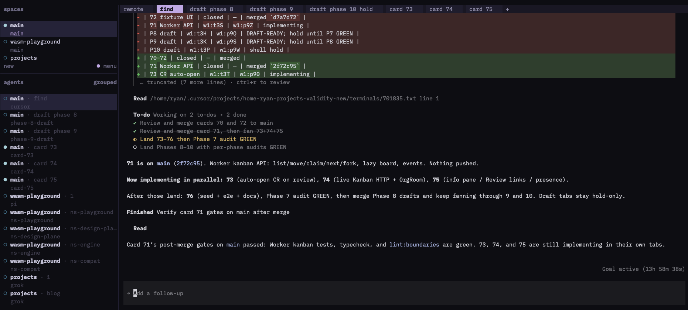

AI assisted development is awesome BUT there's a huge problem, it's not deterministic. Sometimes you get an amazing result that matches what you asked for. Other times you get complete garbage where it's clear the agent went off the rails.

Early restaurant kitchens had the same problem. Inconsistent results, sloppy work.

> Having expected the kitchen of a fine-dining establishment to be serene and sedulous, he instead encountered disagreement, shouting, overwhelming heat and smoke, violence and a staff that spent most of the day in an alcoholic haze.

<a href="https://www.independent.co.uk/independentpremium/long-reads/auguste-escoffier-fine-dining-savoy-b2209385.html">The Independent</a>, on Escoffier's first kitchen in Nice, 1859

In 1890, [Auguste Escoffier](https://en.wikipedia.org/wiki/Auguste_Escoffier) took over the kitchens at the Savoy in London. He had a military background and [standardized a chain of command](https://x.com/ryanlanciaux/status/2084292455566852328) on the line. His cooks weren't necessarily better BUT he ensured a better structure or better set of guardrails were in place.

Escoffier's strategy is known as the [kitchen brigade](https://en.wikipedia.org/wiki/Kitchen_brigade) and I think it maps well to agentic software development.

- **Aboyeur** (the barker) takes orders from the dining room and sends them to the stations -> an orchestrator dispatches tasks. Parallel agents should be structured so they work together instead of ending up with a ton of incoherent updates that just cause merge conflicts and burn tokens unnecessarily.
- **Specialized stations** -> agents with one job.
- **Chef at the pass** -> a verification pass before anything ships. Tests, a reviewer, you.

We can leverage this brigade strategy with our AI to build consistent software. A couple of key principles:

1. Make anything that can be deterministic, deterministic. If something can be run mechanically and get the same result every time, use that instead of an agentic process that could give a different answer.
2. Do the simplest thing that can possibly work. Don't build some massive workflow engine until you find you need it. The tools we use day-to-day are pretty good about classifying and delegating work.
3. Have agents verify their own work. This is critical, and it saves time in one of the areas that's a huge bottleneck: human review.

## Make anything that can be deterministic, deterministic

<blockquote class="twitter-tweet">
If you can check something deterministically, make it deterministic.
- Ryan Lanciaux (@ryanlanciaux) <a href="https://x.com/ryanlanciaux/status/2082807672143802500?ref_src=twsrc%5Etfw">July 30, 2026</a></blockquote>

Lint, types, tests, e2e. If the check is mechanical, don't spend a model call on it. Tests and linting go a long way to prevent breakage, but they don't prove the feature is correct.

## Do the simplest thing that can possibly work

As you're starting this process, you probably only need a few different agent types. Find what doesn't work and add on from there.

- Too many agents in a workflow is orchestration theater. It feels productive to build these massive workflows but it's important to make sure you're getting something in return for the time investment and architectural overhead.
- An orchestrator that writes code can miss out on giving instructions to other agents / firing off other work.
- Agents copy existing patterns. Remove code that doesn't fit the pattern you want other agents to copy. This is like a chef having bad recipes in the kitchen.

## Have agents verify their own work

In a brigade, nothing leaves without going through the pass. "Prompt and hope" skips all that.

In addition to mechanical checks, give agents the ability to [verify correctness before they call something complete](https://x.com/ryanlanciaux/status/2071939559081042257). For instance, I often build [blunders.ai](https://blunders.ai) with this kind of prompt:

"Build this feature. Review it and verify that it works. Give me screenshots to prove that the feature is in place." I'll generally give the agent tools to ensure that the work is complete.

## The simplest process that's currently working for me

I've made my own workflow tools, used ultracode, and installed sub-agent plugins BUT what I like the best is telling one agent to coordinate other agents as Herdr panes.

- A watcher tab or orchestrator. I start a Herdr tab and then an agent. I make sure the agent knows it's using Herdr and then tell it to use other panes and tabs with agents to achieve a goal.
- Individual panes have agents working on a smaller subset of a larger goal, much like kitchen stations focusing on a distinct part of the menu.

<small>~ "Fan out to other agents as Herdr panes and tabs. Clean up after yourself when a tab is complete."</small>

## You don't need better agents first

You don't need better agents first. You need a better strategy for agents to achieve goals effectively. Escoffier's cooks weren't necessarily better. The structure was. The [brigade is still the default](https://en.wikipedia.org/wiki/Kitchen_brigade) in restaurant kitchens a century later (though some smaller kitchens merge roles). The cooks changed, the structure didn't. I think we can learn from this.

