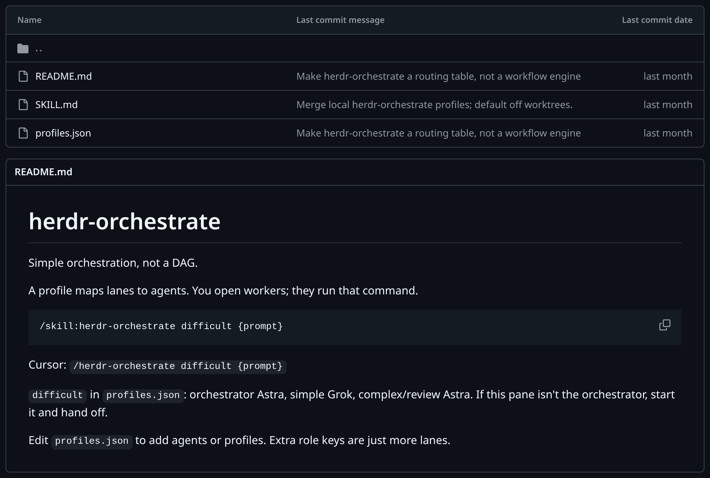
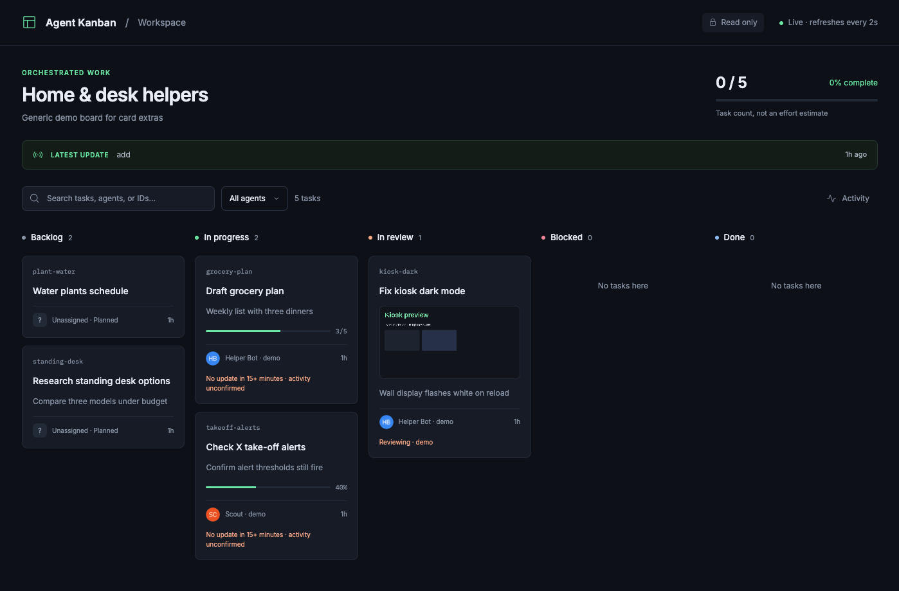

It's been a dream to make progress on projects without being stuck at a computer. I have too many ideas and not enough time, and even in the age of agentic development that hasn't changed. BUT how that work happens, at least on my side projects, is changing. Projects still take some work, focused planning, and experimentation, but my time directly at a computer can come in bursts instead of a sustained hustle with my laptop open. I currently outsource a lot of the communication to Grok Bot to help me manage the work and stay in the loop while I'm away from my desk.

## One point of contact

You can manage a [herdr](https://herdr.dev/) session from your phone, use a custom app, or SSH in with something like Termius. These all work well, and I still use them. BUT sometimes I want something more disconnected. I don't always want to open a terminal connection from my phone. I want to hand off work and hear back when it's complete.

That's where Grok Bot fits. I install it on the computer that runs my projects, and it passes prompts to the right place and tells me what needs my attention. It's persistent and on my phone too, so I can steer the work, check progress, and launch new work from anywhere. I could kick off a fix while I'm in the middle of a house project and check the result when I'm done.

## Handing off to the agents that do the work

I see a lot of people using cloud agents or having Grok Bot do coding work directly. I have most of my side projects on a Linux machine on my desk because I like having more control. I run my coding agents there in herdr. I also have several subscriptions and generally use Claude Code as the entry point to this work. So Grok Bot doesn't write the code but is the coordinator between me and my coding agents on that machine.

I have [a skill](https://github.com/ryanlanciaux/skills/tree/main/herdr-orchestrate) that uses herdr to orchestrate work between my various agent subscriptions. Grok Bot takes my request and hands it off to this orchestrator. I override the default profile to put Claude in charge. Claude drives, splits the work, and hands it out to Grok, Codex, or other Claude agents depending on how complex each part is. A separate agent reviews the result before it comes back to me.



## Following along without running it myself

I still want to know what's happening even when I'm not actively driving the work. Sometimes I'll just message Grok Bot directly, "Where is everything at?" Other times it's proactively telling me as things land. For long-running goals, I've found it helpful to have a read-only kanban view of the work. I made [a skill](https://github.com/ryanlanciaux/skills/tree/main/agent-kanban) that gives agents a way to show their work on a kanban board. It's read-only for the human but provides a good visual.



<small>Fake tasks in agent-kanban</small>

I even set this up on my dashboard kiosk.

<div class="embed-left">
<blockquote class="twitter-tweet" data-align="left"><a href="https://x.com/ryanlanciaux/status/2079179515511619946">View the post on X</a></blockquote>
</div>

<style>
.prose .embed-left .twitter-tweet { margin-inline: 0 !important; float: none !important; }
</style>

## Set it up on your bot

If you want to try it, here's how.

1. Make sure Grok Bot is on the system where you want it to control your other coding agents.
2. Set up agent orchestration with herdr-orchestrate.
3. Give the bot ways to tell you status. As I mentioned, I use a few different ways, but agent-kanban may be helpful.

Here are prompts you can hand to your bot for both skills. Both assume it can run commands on the machine where your coding agents live.

**herdr-orchestrate**

```text
Install the herdr-orchestrate skill from
https://github.com/ryanlanciaux/skills/tree/main/herdr-orchestrate
into the skills folder of the coding agent I use as my orchestrator (Claude
Code, Codex, Pi, Cursor, etc.) on my dev machine. Make sure herdr is installed
(https://herdr.dev/). Read the README and profiles.json, then create
~/.config/herdr-orchestrate/profiles.json with a profile that uses the agent
CLIs I actually have installed. Show me the lane mapping (orchestrator, simple,
complex, reviewer) before saving it. When I send you project work, start the
orchestrator agent in a herdr pane and run the herdr-orchestrate skill with
that profile and my task.
```

**agent-kanban**

```text
Install the agent-kanban skill from
https://github.com/ryanlanciaux/skills/tree/main/agent-kanban
into my coding agent's skills folder on my dev machine. Run its doctor check
(sh scripts/kanban.sh doctor) and tell me if anything is missing. For
long-running goals, have the lead agent use $agent-kanban to start the viewer,
keep task assignments and status current, and send me the board link. Keep it
bound to localhost unless I tell you which private network address to use.
```

## Wrapping up

I'm not fully away from the computer when I'm building my projects, but it's nice to have ways to keep things moving without me. Building systems around the work gives me more confidence in the output and gets more out of the tools I already use.

What are you using to keep your work moving remotely? Other tools I didn't mention? I'd love to hear about it!

<script async src="https://platform.twitter.com/widgets.js" charset="utf-8"></script>
<script>
  document.addEventListener("astro:page-load", () => {
    window.twttr?.widgets?.load()
  })
</script>
